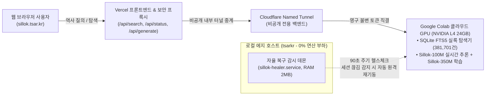

# Sillok-LM & 디지털 춘추관: 조선왕조실록 AI 역사 탐서관
### Historical Archive Explorer & From-Scratch Causal Language Model for the Annals of the Joseon Dynasty

[](https://huggingface.co/darkstar-11e/sillok-100m)
[](https://opensource.org/licenses/Apache-2.0)
[](https://github.com/tsarkr/sillok)
[](https://sillok.tsar.kr)

> **[ 🌐 English Documentation ](#-english-documentation)** | **[ 🇰🇷 한국어 설명 ](#-한국어-설명)**

* **공식 웹 역사 탐서관 (Official Historical Explorer)**: [https://sillok.tsar.kr](https://sillok.tsar.kr) (Mirror: [https://sillok-blue.vercel.app/](https://sillok-blue.vercel.app/))
* **Hugging Face 모델 허브 (Model Hub)**: [https://huggingface.co/darkstar-11e/sillok-100m](https://huggingface.co/darkstar-11e/sillok-100m) (`LlamaForCausalLM` safetensors · 350M 상위 모델 사전학습 진행 중)
* **원천 데이터셋 (Primary Source)**: `교육부 국사편찬위원회_조선왕조실록 정보_실록원문_20260821` (`data/2nd_*.xml`, `673` files · `30` annals · `381,701` articles · `67,707,578` Classical Chinese characters · KOGL Type 1 / AI License)

---

# 🇰🇷 한국어 설명

**디지털 춘추관(Sillok-LM)**은 국사편찬위원회의 조선왕조실록 전수 원문(381,701건)을 기반으로 구축된 **① 팩트 기반 조선 역사 질의·원문 초고속 탐색 플랫폼(SQLite FTS5 + 사관 브리핑)**과 **② Llama-3 아키텍처 기반 From-Scratch 고전 한문 언어모델(`Sillok-100M` / `Sillok-350M`)**을 결합한 디지털 인문학 AI 프로젝트입니다.

## 🌟 핵심 특징 (Key Highlights)

### 1. 🔍 팩트 기반 역사 질의 & 381,701건 실록 원문 탐서관 (`sillok.tsar.kr`)
임의의 문장을 지어내는 단순 생성기(Hallucination 위험)에서 벗어나, **과거 역사에 대해 자연어로 질문하면 실제 실록 원문을 역추적하여 100% 팩트 기반 사료를 제시**합니다.
- **초고속 전문 검색 (SQLite FTS5 + BM25)**: 381,701건의 실록 기사(`title_ko`, `body_hanja`, `postscripts`, `king_name_ko`, `date_reign`, `subjects`)를 수 밀리초(ms) 내에 랭킹 검색합니다.
- **자연어 질의 파싱 & 역사 동의어 확장**: *"장영실이 만든 가마가 부서진 사건"*, *"사도세자 뒤주 사건"*, *"훈민정음 최만리 상소"* 같은 일상 한국어 질문을 입력하면 조사·불용어를 제거하고 당대 실록 용어(`안여`, `임오`, `언문`, `파천` 등)로 자동 확장하여 정확한 원문을 찾아냅니다.
- **AI 사관 역사 브리핑**: 검색된 실제 사료들의 연대기 범위, 관련 왕조 분포, 핵심 기사 요약, 사론 수록 여부를 한눈에 정리해 브리핑합니다.
- **국사편찬위원회 공식 원문 교차 검증**: 모든 검색 결과 카드마다 국사편찬위원회 실록 원문(`sillok.history.go.kr`) 바로가기 링크를 제공합니다.

### 2. 🌱 대중·학생 친화 원문 뷰어 & 사론(史論) 주석
- **한문 원문 & 한글 독음 루비(Ruby) 뷰어**: 웹 표준 `<ruby>` 태그를 적용하여 한자 위에 한글 발음을 실시간 표시하며, 원클릭으로 한자 원문 / 루비 음독 모드를 전환할 수 있습니다.
- **공인 사론 태그 전수 추출 (`<postScript type="史論">`)**: 국사편찬위원회 원본 XML 스키마(`history.dtd`)에 정의된 `<postScript type="史論">` 태그를 통해 **전수 5,873건**의 사관 논평(`【史臣曰: "..."】`)을 정확하게 분리했으며, `사론 포함 기사만 보기` 필터와 전용 강조 카드를 제공합니다.
- **실록 속 역사 낱말 사전 배지 (Glossary)**: 기사에 등장하는 주요 관직·관청·고어(議政府, 承政院, 義禁府, 安與, 諺文, 親鞫 등)의 용어 풀이를 자동 표출합니다.

### 3. 🧪 From-Scratch 조선왕조실록 언어모델 (Sillok-LM 연구 트랙)
- **엄격한 역사 고증 및 XML 계층 파싱**:
  - 한글 기사 제목(`<mainTitle>`)은 조선 목판본 원전에 없던 국사편찬위원회 연구진의 현대어 1줄 요약문임을 명시하고 분리 모델링했습니다.
  - 당일 첫 기사에만 60간지를 적는 실록 원전의 관례를 반영해 `level2(년) ➔ level3(월) ➔ level4(일) ➔ level5(기사)` DOM 계층 상속 파서를 구현했습니다.
- **모델 라인업**:
  - **Sillok-100M** (`100.7M` params, 12L/768H): Hugging Face 공개 완료 (`darkstar-11e/sillok-100m`), 웹 스튜디오의 보조 탭 `AI 사관 원문 생성 실험실`에서 실시간 체험 가능.
  - **Sillok-350M** (`347.1M` params, 26L/1024H, GQA 16:4, BFloat16): NVIDIA L4와 Apple Silicon MPS에서 학습 가능 (`configs/sillok_350m_l4.yaml`, `configs/sillok_350m_mac_mps.yaml`).

### 4. 🤝 사서(司書)와 사관(史官)의 만남: SQLite 검색과 언어모델의 상호보완적 결합
- **SQLite FTS5 (사서의 역할)**: 381,701건의 실록 서고에서 실제 사료를 0.02초(20ms) 만에 정확히 찾아내어 환각(할루시네이션)을 0%로 원천 차단합니다.
- **Sillok-LM & 사관 로직 (사관의 역할)**: 딱딱하고 어려운 한문 사료를 펼쳐 실시간 한글 음독(`<ruby>`)을 달아주고, 고전 관청·사법 용어사전을 매핑하며, 사관의 시각에서 사건의 배경과 결말을 알기 쉽게 브리핑합니다.
- **결합의 시너지**: 검색 엔진만 쓰면 일반인이 읽기 어려운 한문 텍스트만 툭 떨어지고, 모델만 쓰면 유창하지만 역사를 지어내는 문제가 생깁니다. 본 시스템은 SQLite가 100% 진짜 원문 팩트를 잡고, 모델이 이를 누구나 읽기 쉽게 풀어주는 이상적인 RAG(검색 증강 역사 탐서) 아키텍처로 동작합니다.

---

## 🏛️ 무인 자율 운영 시스템 아키텍처

사용자의 로컬 연구 PC(에지 머신)에 0%의 추론·학습 부하를 유지하면서 24시간 끊김 없이 운영되는 3계층 하이브리드 아키텍처입니다:



1. **공식 웹 서비스**: 커스텀 도메인 연동 및 Vercel Serverless 글로벌 CDN 정적 호스팅 ([https://sillok.tsar.kr](https://sillok.tsar.kr))
2. **비공개 고정 백엔드**: Cloudflare Named Tunnel 공식 토큰을 바인딩한 내부 백엔드 파이프라인 (Vercel Serverless 프록시 `/api/search`, `/api/status`, `/api/generate`만 외부 공개)
3. **클라우드 검색 + GPU 연산**: 구글 코랩 NVIDIA L4 GPU 인스턴스에서 381,701건 SQLite FTS5 검색 엔진과 Sillok-LM 추론/학습을 동시 가동
4. **24시간 무인 자율 복구 데몬 (`sillok-healer.service`)**: 로컬 PC 백그라운드에서 90초마다 상태를 점검하며, 코랩 세션 만료 시 원격으로 서버와 고정 터널을 자동 복구 (미니 PC RAM 2MB, CPU 0%)

---

## 📚 교육용 교재 및 기술 문서 (`docs/`)

- **[단행본 통합 교재 (전체 합본)](file:///home/nsua/Dev/sillok/docs/BOOK_SILLOK_LM_COMPLETE.md)** — 데이터 정제, 토크나이저 주조, Transformer 신경망 설계, 원격 GPU 무인 자동화, 30대 실록 통계 및 대중 친화 UI 아키텍처를 총망라한 통합 도서
- **[서문 및 총괄 색인](file:///home/nsua/Dev/sillok/docs/00_BOOK_INDEX.md)** — 목차 구성, 실측 수치 요약, 전체 파일 인덱스
- **[제1장. 원천 데이터 규격 및 XML 파싱 명세](file:///home/nsua/Dev/sillok/docs/01_DATA_AND_XML_SPEC.md)** — `history.dtd ver 1.4`, 30개 실록 통계표, UTF-16 서로게이트 복구, 계층 날짜 상속, 사론(`<postScript>`) 분리
- **[제2장. 시스템 인프라 및 원격 연결 구조](file:///home/nsua/Dev/sillok/docs/02_SYSTEM_AND_REMOTE_ARCHITECTURE.md)** — 에지 호스트(`tsarkr`), 터널링, 저전력 환경 극복 전략
- **[제3장. 토크나이저와 언어모델 구조 이해하기](file:///home/nsua/Dev/sillok/docs/03_TOKENIZER_AND_MODEL_ARCHITECTURE.md)** — 11종 제어 토큰, Byte-Level BPE, RMSNorm, RoPE, GQA, KV-Cache 가속
- **[제4장. 단계별 실행 및 운영 매뉴얼](file:///home/nsua/Dev/sillok/docs/04_TRAINING_AND_OPERATIONS_MANUAL.md)** — XML 파싱부터 FTS5 색인 구축, Memmap 패킹, GPU 사전학습, 모델 배포 가이드

---

## 📂 프로젝트 디렉터리 구조

```text
sillok/
├── api/                            # Vercel Serverless API 프록시 (search.js, status.js, generate.js)
├── configs/
│   ├── sillok_tiny_debug.yaml      # 스모크 테스트용 설정 (5M params)
│   ├── sillok_120m_t4.yaml         # 실전 표준 모델 설정 (100.7M params)
│   ├── sillok_350m_l4.yaml         # NVIDIA L4 24GB 최적화 확장 모델 설정 (347.1M params)
│   ├── sillok_350m_mac_mps.yaml    # Apple Silicon MPS 학습 설정
│   └── sillok_1b_a100.yaml         # 1B 스케일 확장 모델 설정
├── data/
│   ├── 2nd_*.xml                   # 교육부 국사편찬위원회 실록 원문 XML (673개 파일)
│   ├── history.dtd                 # 한국사DB 통합 DTD ver 1.4
│   └── processed/                  # 파싱 산출물 (articles.jsonl, sillok_search.db, train.bin, val.bin)
├── docs/                           # 기술 백서 및 단행본 도서 통합 원고
├── public/                         # Vercel 배포용 AI 역사 탐서관 프론트엔드 (index.html)
├── scripts/
│   ├── 01_parse_xml.py             # 673개 XML 병렬 파싱 (사론·날짜 분리)
│   ├── 02_train_tokenizer.py       # 한문·한글 공용 32K Byte-Level BPE 토크나이저 학습
│   ├── 03_prepare_memmap.py        # blake2b 스트리밍 분할 + uint16 바이너리 패킹
│   ├── 04_pretrain.py              # PyTorch 기반 From Scratch 사전학습 스크립트
│   ├── 05_generate.py              # CLI 조건부 실록 생성기
│   ├── 09_export_infer.py          # FP16 경량 추론 가중치 추출
│   ├── 10_interactive_cli.py       # 대화형 터미널 사관 스튜디오
│   ├── 12_export_to_huggingface.py # Hugging Face LlamaForCausalLM safetensors 변환기
│   ├── 13_build_search_db.py       # 381,701건 SQLite FTS5 전문 검색 색인 빌더
│   ├── 14_train_with_hf_sync.py    # 휘발성 Colab 런타임 대비 Hugging Face 체크포인트 동기화 러너
│   └── colab_studio_server.py      # 클라우드 실록 탐색기 + GPU 추론 통합 REST API 서버
└── src/sillok/                     # 핵심 파이썬 패키지 (data, tokenizer, model, training, remote)
```

---

# 🌐 English Documentation

**Digital Chunchugwan & Sillok-LM** is a digital humanities AI platform built upon the complete 500-year corpus of the **Annals of the Joseon Dynasty** (*Joseon Wangjo Sillok*, 381,701 articles), published by the National Institute of Korean History (NIKH).

It combines:
1. **Fact-Grounded Historical Archive Explorer (`https://sillok.tsar.kr`)**: Ask questions about Korean history in natural language and retrieve authentic primary-source Annals entries in milliseconds via an indexed SQLite FTS5 / BM25 archive engine — complete with native `<ruby>` phonetic Hanja readings, official NIKH modern summaries, 5,873 royal historiographer commentaries (*Saron*), historical glossary definitions, and AI Scribe historical briefings.
2. **From-Scratch Classical Chinese Language Models (`Sillok-100M` / `Sillok-350M`)**: Modern Llama-3 Transformer models trained from scratch on 67.7M Classical Chinese characters, accessible via Hugging Face Hub and the studio's secondary *AI Scribe Generation Lab* tab.

## 🌟 Key Innovations

### 1. 🔍 Fact-Grounded Historical Q&A & Archive Retrieval (`sillok.tsar.kr`)
- **Zero-Hallucination Primary Sources**: Rather than fabricating pseudo-historical titles, user queries search directly across all **381,701 authentic Annals articles** using SQLite FTS5 with BM25 column weighting (`title_ko`, `postscripts`, `body_hanja`, `king_name_ko`, `subjects`).
- **Natural-Language Parsing & Historical Synonym Expansion**: Automatically strips Korean particles/stopwords and maps modern historical terms (e.g., *palanquin*, *Hangul*, *rice chest*, *royal refuge*) to contemporary Annals terminology (`安與`, `諺文`, `파천`, etc.).
- **AI Scribe Briefing & NIKH Verification**: Summarizes the matched timeframe, reign distribution, top primary sources, and links directly to the official NIKH archive (`sillok.history.go.kr`).

### 2. Strict XML & Historiographical Rigor
- **Official Editorial Verdict Extraction (`<postScript type="史論">`)**: Exactly **5,873 historiographer verdicts** (*Saron*, `【史臣曰: "..."】`) are parsed from the official NIKH `history.dtd` schema, indexed for dedicated Saron-only filtering, and rendered in highlighted commentary cards.
- **Chronological Date Context Hierarchy**: Preserves the Annals convention of recording the 60-Ganji date only on the first entry of each day via XML DOM tree context inheritance (`level2(Year) ➔ level3(Month) ➔ level4(Day) ➔ level5(Article)`).
- **Student & Public Accessibility**: Native HTML `<ruby>` phonetic annotations above Classical Chinese characters and automatic glossary badges for premodern government offices (*Uijeongbu*, *Seungjeongwon*, *Uigeumbu*, etc.).

### 3. From-Scratch Sillok-LM Model Family
- **Sillok-100M (`100.7M` params)**: Published on Hugging Face (`darkstar-11e/sillok-100m`) in standard `LlamaForCausalLM` safetensors format.
- **Sillok-350M (`347.1M` params, 26 layers, 1024 hidden, GQA 16:4, BFloat16)**: Currently pretraining on Google Colab GPU (`configs/sillok_350m_l4.yaml`, Step 1,250 checkpoint synchronized to Hugging Face).

### 4. 🤝 The Scribe and the Chronicler: Synergy of SQLite Search and Sillok-LM
- **SQLite FTS5 (The Scribe/Librarian)**: Instantly retrieves authentic primary-source articles from all 381,701 entries in ~20ms, eliminating hallucination entirely.
- **Sillok-LM & Scribe Logic (The Historiographer)**: Annotates Classical Chinese text with real-time phonetic Hangul readings (`<ruby>`), links court terminology to premodern glossaries, and generates contextual historical briefings in the authentic tone of Joseon royal chroniclers.
- **Why This Synergy Wins**: Pure LLMs hallucinate dates and historical figures; pure databases return raw, unreadable Classical Chinese. Digital Chunchugwan anchors every answer to 100% verified primary sources while delivering effortless readability for modern students and researchers.

---

## 🚀 Quick Start

### 1. Installation & Search Index Build
```bash
git clone https://github.com/tsarkr/sillok.git
cd sillok
pip install -e .

# Build the 381,701-article SQLite FTS5 search database
python3 scripts/13_build_search_db.py --input data/processed/articles.jsonl --output data/processed/sillok_search.db
```

### Apple Silicon 350M Training
```bash
.venv/bin/python scripts/04_pretrain.py --config configs/sillok_350m_mac_mps.yaml
```

### 2. Hugging Face Inference (`Sillok-100M`)
```python
import torch
from transformers import AutoModelForCausalLM, AutoTokenizer

model_id = "darkstar-11e/sillok-100m"
tokenizer = AutoTokenizer.from_pretrained(model_id)
model = AutoModelForCausalLM.from_pretrained(model_id, torch_dtype=torch.float16, device_map="auto")

prompt = "<|bos|><|king|>세종실록(世宗實錄)<|date|>세종 28년 9월 29일 | 庚戌<|subject|>문화-출판/인쇄<|title|>어제 훈민정음 서책을 완성하여 인쇄하게 하다<|hanja|>"
inputs = tokenizer(prompt, return_tensors="pt").to(model.device)
outputs = model.generate(**inputs, max_new_tokens=60, temperature=0.6, repetition_penalty=1.15)
print(tokenizer.decode(outputs[0], skip_special_tokens=False))
```

---

## 📜 License & Citation

- **Source Code**: [Apache License 2.0](LICENSE)
- **Primary Source Data**: National Institute of Korean History (NIKH), Ministry of Education, Republic of Korea (KOGL Type 1 & AI Compliant)
- **Model Checkpoints**: [darkstar-11e/sillok-100m](https://huggingface.co/darkstar-11e/sillok-100m) (Apache-2.0)
