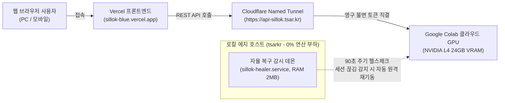

# Sillok-LM: 조선왕조실록 From Scratch 생성형 언어모델

[](https://huggingface.co/darkstar-11e/sillok-100m)
[](https://opensource.org/licenses/Apache-2.0)
[](https://github.com/tsarkr/sillok)
[](https://vercel.com/new/clone?repository-url=https%3A%2F%2Fgithub.com%2Ftsarkr%2Fsillok)

* **공식 웹 사관 스튜디오 (Vercel Live)**: [https://sillok-blue.vercel.app/](https://sillok-blue.vercel.app/)
* **영구 백엔드 API (Cloudflare Named Tunnel)**: [https://api-sillok.tsar.kr](https://api-sillok.tsar.kr)
* **Hugging Face 모델 허브**: [https://huggingface.co/darkstar-11e/sillok-100m](https://huggingface.co/darkstar-11e/sillok-100m) (LlamaForCausalLM 규격)
* **원천 데이터셋**: `교육부 국사편찬위원회_조선왕조실록 정보_실록원문_20260821` (`data/2nd_*.xml`, `673`개 파일 · `30`개 실록 · `381,701`개 기사 · 한문 `67,707,578`자 · 공공누리 제1유형/AI유형)

본 프로젝트는 국사편찬위원회의 조선왕조실록 원전 빅데이터를 기반으로 **Llama-3 아키텍처 기반 Decoder-only Transformer (`SillokForCausalLM`, 100.7M 파라미터)**를 밑바닥부터(From Scratch) 학습하고, 누구나 한자 부담 없이 실록을 즐길 수 있도록 대중 친화 웹 스튜디오와 무인 자율 복구 클라우드 GPU 인프라를 구축한 디지털 인문학 AI 프로젝트입니다.

---

## 🌟 핵심 특징 (Key Highlights)

### 1. 역사 사료와 현대 연구자 언어를 잇는 양방향 신경망
- **한글 기사 제목의 본질**: 조선 시대 실록 목판본 원전에는 기사별 제목(헤드라인)이 존재하지 않습니다. 본 프로젝트의 한글 제목은 국사편찬위원회 연구진이 디지털화 과정에서 기사 핵심을 1줄로 압축한 **공인 현대 한국어 요약문(`<mainTitle>`)**입니다.
- **양방향(Bi-directional) 학습 구조**:
  - **정방향 실록 집필 (`<|title|>한글제목 ➔ <|hanja|>한문원문`)**: 현대 연구자가 주제나 한글 제목을 제시하면 당대 사관 문체의 편년체 한문 사초를 복원 및 창작합니다.
  - **역방향 사초 요약 (`<|hanja|>한문원문 ➔ <|title|>한글제목`)**: 번역되지 않은 고전 한문 사초를 입력하면 마치 국편위 연구원이 요약한 듯한 정제된 한글 기사 제목을 자동 추출합니다.

### 2. 엄격한 역사 고증과 원본 XML 파싱 규격
- **공인 사론 태그 전수 추출 (`<postScript type="史論">`)**: 사관의 역사 비평인 사론(史論, `【史臣曰: "..."】`)은 국사편찬위원회 원본 XML 스키마(`history.dtd`)에 정의된 `<postScript type="史論">` 태그를 통해 **전수 5,873건**을 정확하게 분리 수집하여 `<|postscript|>` 제어 토큰으로 학습시켰습니다.
- **편년체 날짜 계층 상속 (Tree Context Inheritance)**: 실록 원전의 표기 관례(당일 첫 기사에만 60간지를 적고 후속 기사는 날짜 생략)를 반영하여, `level2(년) ➔ level3(월) ➔ level4(일) ➔ level5(기사)`의 부모 일자 노드 컨텍스트를 자식 기사들이 안전하게 상속받도록 파서를 설계했습니다.

### 3. 🌱 대중·학생 친화 모드 (Friendly Studio Mode)
- **한문 원문 & 한글 독음 루비(Ruby) 뷰어**: 웹 표준 `<ruby>` 태그를 적용하여 한자 위에 한글 발음을 실시간 표시하며, `[독음 함께 보기]`, `[순수 한글만 읽기]`, `[한문만 보기]` 전환을 지원합니다.
- **사관의 현대어 3줄 이야기 브리핑**: 생성된 기사의 역사적 배경, 조정의 논의, 결말을 알기 쉬운 현대어로 3줄 요약 카드로 제공합니다.
- **사관의 촌철살인 한마디 (사론 카드)**: 성리학적 도덕률과 인물 비평이 담긴 사관의 총평을 왕실 인장 양식 카드로 표출합니다.
- **실록 속 역사 낱말 사전 칩 (Glossary Chips)**: 기사에 등장하는 주요 관직·관청(의정부, 육조, 승정원 등)의 용어 풀이를 자동 표시합니다.

---

## 🏛️ 무인 자율 운영 시스템 아키텍처

사용자의 로컬 연구 PC(에지 머신)에 0%의 추론 부하를 유지하면서 24시간 끊김 없이 운영되는 3계층 하이브리드 아키텍처입니다:



1. **프론트엔드**: Vercel Serverless를 통한 글로벌 CDN 정적 호스팅 ([sillok-blue.vercel.app](https://sillok-blue.vercel.app/))
2. **영구 고정 백엔드**: Cloudflare Named Tunnel 공식 토큰을 바인딩한 고정 도메인 ([https://api-sillok.tsar.kr](https://api-sillok.tsar.kr))
3. **추론 연산**: 구글 코랩 NVIDIA L4 GPU 상에서 Hugging Face 포맷 모델 즉시 가동 (FP16 추론)
4. **24시간 무인 자율 복구 데몬 (`sillok-healer.service`)**: 로컬 PC 백그라운드에서 90초마다 상태를 점검하며, 코랩 세션 만료 시 원격으로 L4 GPU 서버와 고정 터널을 자동 복구 (미니 PC RAM 2MB, CPU 0%)

---

## 📚 교육용 교재 및 기술 문서 (`docs/`)

인문학 전공 학생과 연구자가 기초부터 실전까지 따라갈 수 있도록 정리한 기술 백서입니다:

- **[단행본 통합 교재 (전체 합본)](file:///home/nsua/Dev/sillok/docs/BOOK_SILLOK_LM_COMPLETE.md)** — 데이터 정제, 토크나이저 주조, Transformer 신경망 설계, 원격 GPU 무인 자동화, 30대 실록 통계 및 대중 친화 UI 아키텍처를 총망라한 통합 도서
- **[서문 및 총괄 색인](file:///home/nsua/Dev/sillok/docs/00_BOOK_INDEX.md)** — 목차 구성, 실측 수치 요약, 전체 파일 인덱스
- **[제1장. 원천 데이터 규격 및 XML 파싱 명세](file:///home/nsua/Dev/sillok/docs/01_DATA_AND_XML_SPEC.md)** — `history.dtd ver 1.4`, 30개 실록 통계표, UTF-16 서로게이트 복구, 계층 날짜 상속, 사론(`<postScript>`) 분리
- **[제2장. 시스템 인프라 및 원격 연결 구조](file:///home/nsua/Dev/sillok/docs/02_SYSTEM_AND_REMOTE_ARCHITECTURE.md)** — 에지 호스트(`tsarkr`), SSH 터널링, 메모리 3.7GB 저전력 환경 극복 전략
- **[제3장. 토크나이저와 언어모델 구조 이해하기](file:///home/nsua/Dev/sillok/docs/03_TOKENIZER_AND_MODEL_ARCHITECTURE.md)** — 11종 제어 토큰, Byte-Level BPE, RMSNorm, RoPE, GQA, KV-Cache 가속
- **[제4장. 단계별 실행 및 운영 매뉴얼](file:///home/nsua/Dev/sillok/docs/04_TRAINING_AND_OPERATIONS_MANUAL.md)** — XML 파싱부터 스트리밍 Memmap 패킹, GPU 사전학습, 모델 배포 가이드

---

## 📂 프로젝트 디렉터리 구조

```text
sillok/
├── api/                            # Vercel Serverless API 프록시 (status.js, generate.js)
├── configs/
│   ├── sillok_tiny_debug.yaml      # 스모크 테스트용 설정 (5M params)
│   ├── sillok_100m_t4.yaml         # 실전 표준 모델 설정 (100.7M params)
│   └── sillok_350m_a100.yaml       # 확장 모델 설정 (347M params)
├── data/
│   ├── 2nd_*.xml                   # 교육부 국사편찬위원회 실록 원문 XML (673개 파일)
│   ├── history.dtd                 # 한국사DB 통합 DTD ver 1.4
│   └── processed/                  # 전수 파싱 산출물 (articles.jsonl, train.bin, val.bin)
├── docs/                           # 기술 백서 및 단행본 도서 통합 원고
├── public/                         # Vercel 배포용 웹 스튜디오 프론트엔드 (index.html)
├── scripts/
│   ├── 01_parse_xml.py             # 673개 XML 병렬 파싱 (사론·날짜 분리)
│   ├── 02_train_tokenizer.py       # 한문·한글 공용 32K Byte-Level BPE 토크나이저 학습
│   ├── 03_prepare_memmap.py        # blake2b 스트리밍 분할 + uint16 바이너리 패킹
│   ├── 04_pretrain.py              # PyTorch 기반 From Scratch 사전학습 스크립트
│   ├── 05_generate.py              # CLI 조건부 실록 생성기
│   ├── 09_export_infer.py          # 1.2GB 가중치를 240MB FP16 infer.pt로 경량 추출
│   ├── 10_interactive_cli.py       # 번호 선택식 대화형 터미널 사관 스튜디오
│   ├── 11_serve_web_studio.py      # 로컬 상주형 웹 스튜디오 서버 (:8020)
│   └── 12_export_to_huggingface.py # Hugging Face LlamaForCausalLM safetensors 변환기
├── src/sillok/
│   ├── constants.py                # 30종 국왕 코드 매핑, 11종 제어 특수 토큰
│   ├── data/                       # xml_parser.py, formatting.py, dataset.py
│   ├── tokenizer/                  # trainer.py (Byte-Level BPE)
│   ├── model/                      # config.py, transformer.py (Llama-3 아키텍처)
│   ├── training/                   # trainer.py, generate.py (KV-Cache 추론 엔진)
│   └── remote/                     # colab_env.py
├── colab-gpu-bridge/               # 24/7 원격 GPU 자율 복구 및 MCP 관리 도구
│   ├── sillok_auto_healer.py       # 90초 주기 헬스체크 및 원격 자동 기동 데몬
│   ├── colab_mcp_proxy.py          # Google Colab MCP 프록시
│   └── colab_oauth.py              # Google OAuth 2.0 자동 갱신 모듈
└── index.html                      # 로컬 및 정적 서빙용 메인 웹페이지
```

---

## 🚀 빠른 시작 (Quick Start)

### 1. Python 환경 설정 및 라이브러리 설치
```bash
git clone https://github.com/tsarkr/sillok.git
cd sillok
pip install -e .
```

### 2. Hugging Face 사전학습 모델 즉시 추론
```python
import torch
from transformers import AutoModelForCausalLM, AutoTokenizer

model_id = "darkstar-11e/sillok-100m"
tokenizer = AutoTokenizer.from_pretrained(model_id)
model = AutoModelForCausalLM.from_pretrained(model_id, torch_dtype=torch.float16, device_map="auto")

# 편년체 제어 프롬프트 조립
prompt = "<|bos|><|king|>세종실록(世宗實錄)<|date|>세종 28년 9월 29일 | 庚戌<|subject|>문화-출판/인쇄<|title|>어제 훈민정음 서책을 완성하여 인쇄하게 하다<|hanja|>"

inputs = tokenizer(prompt, return_tensors="pt").to(model.device)
outputs = model.generate(**inputs, max_new_tokens=60, temperature=0.6, repetition_penalty=1.15)
print(tokenizer.decode(outputs[0], skip_special_tokens=False))
```

### 3. 번호 선택형 대화형 CLI 사관 실행
```bash
python3 scripts/10_interactive_cli.py
# 1~10번 역사 프리셋 선택 또는 30대 국왕 / 60간지 직접 지정 생성
```

---

## 📜 라이선스 및 데이터 출처 표기

- **소스코드 라이선스**: [Apache License 2.0](LICENSE)
- **원천 데이터**: 교육부 국사편찬위원회 조선왕조실록 원문 (공공누리 제1유형: 출처표시 및 공공누리 AI유형 준수)
- **배포 모델 가중치**: [darkstar-11e/sillok-100m](https://huggingface.co/darkstar-11e/sillok-100m) (Apache-2.0, 상업적·학술적 자유 이용 가능)
