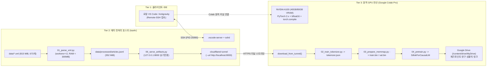

# 제2장. 시스템 인프라 및 원격 분산 아키텍처 (tsarkr ↔ Colab Pro A100)

본 장에서는 실제 개발·전처리 호스트(`tsarkr`)의 하드웨어 및 프로세스 환경 제약을 정밀하게 분석하고, 로컬 IDE와 Cloudflare Tunnel, Google Colab Pro A100 원격 GPU를 결합한 3계층(3-Tier) 분산 학습 아키텍처를 기술한다.

---

## 2.1 호스트(`tsarkr`) 하드웨어 및 OS 사양 실측

2026년 11월 15일 기준 전처리 및 코드 호스팅을 담당하는 Linux 호스트(`tsarkr`)의 실측 사양은 다음과 같다.

| 항목 | 실측 값 | 비고 |
| :--- | :--- | :--- |
| **호스트명 / 커널** | `tsarkr` / `Linux 6.8.0-149-generic #149-Ubuntu SMP PREEMPT_DYNAMIC x86_64` | 64비트 x86_64 리눅스 |
| **운영체제** | `Ubuntu 24.04.5 LTS` (Noble Numbat) | PEP 668 시스템 Python 보호 환경 |
| **Python 런타임** | `Python 3.12.3` (`/usr/bin/python3`) | 시스템 내 `PyYAML 6.0.1` 기본 탑재 (`torch`/`numpy` 미설치) |
| **CPU** | `Intel(R) Celeron(R) CPU J3160 @ 1.60GHz` | 1 소켓, 4 물리 코어, 하이퍼스레딩 미지원 (4 스레드) |
| **메모리 (RAM / Swap)** | 물리 RAM `3.7 GiB` (가용 약 `1.1 GiB`) / Swap `3.7 GiB` | IDE 서버 상주 시 여유 RAM이 제한적 |
| **스토리지** | `/dev/sda3` 총 `114 GiB` (사용 `22 GiB`, 여유 `87 GiB`) | `data/` 원천 XML `815 MiB` + JSONL `352 MiB` 수용 |
| **로컬 GPU** | 없음 (`nvidia-smi` 미설치) | 모델 학습은 원격 Colab Pro A100 전담 |

---

## 2.2 상주 프로세스 및 네트워크 토폴로지 분석

호스트에서 관측된 핵심 백그라운드 프로세스 목록과 역할은 다음과 같다.

| UID | PID | 명령어 / 프로세스 | 계층 내 역할 |
| :--- | :--- | :--- | :--- |
| `root` | `1265` | `sshd: /usr/sbin/sshd -D [listener] 0 of 10-100 startups` | SSH 데몬 리스너 (원격 개발 접속 진입점) |
| `nsua` | `7700`, `9140` | `/usr/bin/ssh-agent /bin/bash /home/nsua/.xsession` | X11/SSH 인증 키 에이전트 세션 |
| `nsua` | `10485` | `cloudflared tunnel --url http://localhost:8000` | 로컬 `8000` 포트를 외부 HTTPS URL로 노출하는 Cloudflare Quick Tunnel |
| `root` | `25912` | `sshd: nsua [priv]` | 사용자 `nsua` SSH 인증 세션 |
| `nsua` | `25990` | `sshd: nsua@notty` | VS Code Remote-SSH 비대화형 채널 |
| `nsua` | `26092` | `sh .../code-server --connection-token=remotessh ...` | VS Code Server 부트스트랩 셸 |
| `nsua` | `26096` | `node .../out/server-main.js --connection-token=remotessh ...` | VS Code Remote-SSH 메인 에이전트 (약 195 MB RSS) |
| `nsua` | `27983`, `28094` | `pet server`, `vscode-pylance/dist/server.bundle.js` | Python 환경 탐색기 및 Pylance 언어 서버 (약 824 MB RSS) |

### 메모리 제약 진단과 설계 귀결
`tsarkr` 호스트는 총 `3.7 GiB` 물리 메모리 중 OS, `.vscode-server` (`node`), `Pylance` (`~824 MiB` RSS)가 상시 약 `2.6 GiB`를 점유한다. 따라서 **남은 가용 RAM 약 `1.1 GiB` 범위 안에서 815 MiB XML과 381,701건의 JSONL을 안전하게 처리**해야 하는 설계 제약이 도출되었다.

---

## 2.3 3계층(3-Tier) 원격 개발·학습 아키텍처

---

## 2.4 제약 환경 맞춤형 소프트웨어 엔지니어링

### 1) 무의존성(Zero-Dependency) 전처리 계층 분리
- 로컬 `tsarkr` 호스트의 시스템 Python(`3.12.3`)에는 `torch`, `numpy`, `tokenizers`, `tqdm`이 설치되어 있지 않다.
- [src/sillok/\_\_init\_\_.py](file:///home/nsua/Dev/sillok/src/sillok/__init__.py), [src/sillok/data/\_\_init\_\_.py](file:///home/nsua/Dev/sillok/src/sillok/data/__init__.py), [src/sillok/model/\_\_init\_\_.py](file:///home/nsua/Dev/sillok/src/sillok/model/__init__.py)는 `__getattr__` 기반 **지연 임포트(Lazy Import)**를 사용하여, 로컬에서 `scripts/01_parse_xml.py`, `scripts/06_serve_artifacts.py`, `SillokLMConfig`, 표준 단위 테스트를 외부 패키지 설치 없이 즉시 실행할 수 있도록 격리하였다.

### 2) 저메모리 병렬 파싱 워커 상한 (`_default_worker_count`)
- [src/sillok/data/xml_parser.py](file:///home/nsua/Dev/sillok/src/sillok/data/xml_parser.py)의 `_default_worker_count()`는 `/proc/meminfo`의 `MemTotal` 값을 읽어 총 RAM이 `6 GiB` 미만인 경우 워커 수를 자동으로 최대 `2`개로 제한한다.
- 또한 XML 파일 단위로 파싱한 뒤 즉시 JSONL 스트림에 기록하고 메모리에서 해제하므로, 전체 673개 XML 파싱 시에도 스왑 쓰래싱 없이 안정적으로 완료된다.

### 3) `blake2b` 기반 스트리밍 Train/Val 분할 (`03_prepare_memmap.py`)
- 381,701개의 `SillokArticle` 객체를 Python 리스트에 모두 적재해 `random.shuffle()`을 호출할 경우 수백 MB 이상의 힙 메모리가 소모된다.
- [scripts/03_prepare_memmap.py](file:///home/nsua/Dev/sillok/scripts/03_prepare_memmap.py)는 `is_validation_article(article_id, val_ratio, seed)` 함수를 통해 `blake2b(f"{seed}:{article_id}")` 해시 버킷으로 각 기사를 읽는 즉시 Train/Val 스트림에 분배하고, `1,000,000` 토큰 버퍼 단위로 `train.bin`/`val.bin`에 flush함으로써 피크 메모리를 50 MB 이하로 유지한다.

### 4) Cloudflare Tunnel 연계 읽기 전용 아티팩트 서버 (`06_serve_artifacts.py`)
- 호스트에 이미 기동 중인 `cloudflared tunnel --url http://localhost:8000` (PID `10485`)을 별도 재설정 없이 그대로 활용하기 위해 [scripts/06_serve_artifacts.py](file:///home/nsua/Dev/sillok/scripts/06_serve_artifacts.py)를 구현하였다.
- `127.0.0.1:8000`에 바인딩되는 `ThreadingHTTPServer`는 디렉토리 순회 공격(Path Traversal)을 차단하며, 오직 `/processed/` (`data/processed/`)와 `/artifacts/` (`artifacts/`) 경로 및 `/manifest.json` 인덱스만 읽기 전용으로 노출한다.
- 원격 Colab 인스턴스에서는 [src/sillok/remote/colab_env.py](file:///home/nsua/Dev/sillok/src/sillok/remote/colab_env.py)의 `download_from_tunnel()` 함수를 호출하여 1 MiB 청크 스트리밍으로 `articles.jsonl`, `train.bin`, `val.bin`, `tokenizer.json`을 안전하게 내려받는다.

### 5) 원격 런타임 및 호스트 프로세스 자동 진단 (`colab_env.py`)
- `detect_runtime()`은 `/proc/meminfo`, `/proc/cpuinfo`, `/proc/<pid>/cmdline`, `torch.cuda` 상태를 통합 수집하여 `RuntimeInfo`와 `HostProcessInfo`로 반환한다.
- 이를 통해 동일한 코드베이스가 현재 **에지 호스트(`tsarkr`)**에서 도는지 **Colab Pro A100**에서 도는지 자동으로 판별한다.
